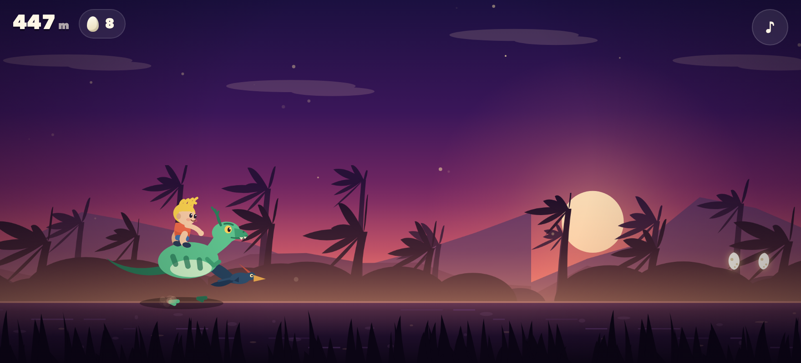

# Sprout & Raptor

A one-thumb endless runner starring a blonde toddler and his velociraptor. Runs in any
modern phone or desktop browser. No build step, no dependencies, no server — the whole
game is one `index.html` with procedurally drawn art and synthesized sound.



## How to play

| | |
|---|---|
| **Tap / click / Space** | Jump |
| **Hold** | Jump higher |
| **Tap again mid-air** | Double jump |
| **M** | Mute |
| **1 / 2 / 3** | Pick difficulty in the menu |

Keep the pair out of rocks, stumps, bone piles, boulders, tall rock spires and
low-swooping pterodactyls — plus twin slabs and rock walls in Reckless. Each egg is
worth **5 m**. Best run is saved per difficulty.

### Difficulty

| Mode | Start speed | Ramp | Gap between hazards | Extras |
|---|---|---|---|---|
| **Chill** | 360 | +10 /s | 1.06–1.62 s | pteros at 16 s |
| **Normal** | 420 | +15.5 /s | 0.78–1.28 s | pteros 6 s, boulders 13 s, spires 18 s |
| **Reckless** | 480 | +22 /s | 0.62–1.02 s | everything sooner, fast pteros, twin slabs at 5 s, rock walls at 16 s |

**There is no speed ceiling in any mode.** Speed climbs forever, so the run ends when
the gap between a hazard appearing at the edge of the screen and reaching you gets
shorter than you can react to:

| Speed | Warning time |
|---|---|
| 1,120 (old cap) | 0.90 s |
| 2,000 | 0.50 s |
| 3,000 | 0.34 s |

That is the wall you eventually hit — around 2–3 minutes of flawless running on Normal.
Hazards are spaced by *arrival* time rather than spawn distance, so obstacles stay
clearable even at absurd speeds; it's reaction time that runs out.

The game is designed for landscape. In portrait it shows a "turn your phone" prompt
(tap *play anyway* if you want to play in a narrow window).

## Try it right now

Double-click `index.html`. That's it — it works straight off the filesystem.

Or serve the folder if you want the home-screen/offline features (a service worker
needs `http(s)`):

```sh
python3 -m http.server 8000     # then open http://localhost:8000
```

## Share it with friends (free)

Any static host works, because there is nothing to compile. Pick one:

**Cloudflare Pages** — fast, free, no CLI.
1. Go to <https://pages.cloudflare.com> → *Upload assets*.
2. Drag this whole folder in.
3. You get a URL like `https://sprout-raptor.pages.dev` — send that to friends.

**Netlify Drop** — the least ceremony.
1. Go to <https://app.netlify.com/drop>.
2. Drag the folder onto the page. Done.

**GitHub Pages** — if you want it in git.
```sh
git init && git add . && git commit -m "Sprout & Raptor"
gh repo create sprout-raptor --public --source=. --push
```
Then in the repo: *Settings → Pages → Source: Deploy from branch → main / (root)*.
The game lands at `https://<user>.github.io/sprout-raptor/`.

A custom domain is the only thing that costs money (~$10–15/year). Everything above
is free at this scale, and stays free for a few hundred players.

### Fullscreen on a phone

**iPhone / iPad — the only route is Add to Home Screen.** Safari on iOS cannot hide its
own URL bar from a web page: the Fullscreen API there only applies to `<video>`, not to
pages, and the browser chrome is not page-controllable. Installed home-screen apps run
with no browser chrome at all:

1. Open the game in **Safari** (must be `http(s)`, not a `file://` copy).
2. Tap the **Share** button → **Add to Home Screen** → *Add*.
3. Launch it from the new icon: no URL bar, no tab bar, just the game.

The menu shows this tip automatically when it detects iOS Safari and isn't already
running standalone. The status bar (clock/battery) still overlays the top of the canvas —
that's unavoidable — and the HUD offsets itself using the safe-area insets so the score
is never hidden behind it.

**Android** — Chrome → **⋮** → *Add to Home screen* / *Install app*, which is fullscreen
thanks to `"display": "fullscreen"` in the manifest. In-browser there's also a fullscreen
button in the top-right HUD.

**Desktop / iPad** — the same HUD button, or <kbd>F11</kbd> / <kbd>⌃⌘F</kbd>. The button
hides itself on iPhone, where it would do nothing.

### Send it to a phone
- A plain link is enough — no app store, no install.
- iOS Safari: *Share → Add to Home Screen* → it opens fullscreen with the raptor icon.
- Android Chrome: *⋮ → Add to Home screen / Install app*.
- Once visited, the service worker keeps it playable offline.

## Tweaking the game

Most knobs are near the top of the `<script>` in `index.html`:

| What | Where | Default |
|---|---|---|
| Jump strength / gravity | `PHYS` | `jump: 880`, `gravity: 2500` |
| Difficulty modes | the `MODES` object near the top of the script | chill / normal / reckless |
| Run speed and ramp | `update()` → `game.speed = M.start + game.t * M.ramp` | uncapped |
| Hazard types & timing | `spawnObstacle()` → the `M.ptero` / `M.boulder` / `M.spire` / `M.twin` / `M.wall` thresholds | |
| Obstacle spacing | `spawnObstacle()` → `closing * rand(M.gap[0], M.gap[1])` | |
| Egg frequency | `spawnEggArc()` → `game.speed * rand(2.3, 3.6)` | |
| Colours | the `C` palette object | dusk jungle |
| Character art | `drawRig()` / `drawBoy()` / `drawObstacle()` | vector, no image files |

Difficulty is governed by that one speed line plus the spawn gaps: if you raise the
top speed, raise the gaps too (they are multipliers of speed, so time-between-hazards
stays roughly constant).

## What's in here

```
index.html            the whole game (HTML + CSS + JS, no assets to load)
manifest.webmanifest  installable-app metadata (name, icon, landscape)
sw.js                 network-first offline cache
icon.svg / .png       app icons (180 px for iOS home screen, 192/512 for the manifest)
docs/                 preview images
tests/                automated playtests (see below)
```

## Tests

`tests/` holds headless harnesses used while building; open them in a browser with the
folder served, or run them headless:

```sh
python3 -m http.server 8777
# fairness: 6 minutes of a scripted player that jumps at hazards
chrome --headless=new --virtual-time-budget=25000 --dump-dom \
  "http://localhost:8777/tests/sim.html?mode=bot&frames=21600"
# hazards really kill: same run with a player that never jumps
chrome --headless=new --virtual-time-budget=25000 --dump-dom \
  "http://localhost:8777/tests/sim.html?mode=idle&frames=21600"
# tap path through the overlays: start, jump, double jump, restart
chrome --headless=new --virtual-time-budget=15000 --dump-dom \
  "http://localhost:8777/tests/input.html"
# jump heights
chrome --headless=new --virtual-time-budget=8000 --dump-dom \
  "http://localhost:8777/tests/sim.html?mode=apex"
```

Add `&diff=chill|normal|reckless` to test a specific mode. Current results: a scripted
player survives 6 minutes on Normal (reaching 6,000 px/s) and averages ~790 m on
Reckless; an idle player dies at the first hazard (~85 m); tap-jump, double-jump,
restart and the difficulty selector all pass.

`index.html` also takes two optional query flags: `?autoplay=1` skips the menu
(add `&t=15` to fast-forward) and `?dev=1` exposes `window.__SR` for debugging and
frame-stepping.

## Not included (and what it would cost to add)

- **Global leaderboards / multiplayer** — needs a backend. Cloudflare Workers + KV is
  free at this scale; an hour or two of work.
- **Music and better SFX** — currently synthesised beeps; real audio means asset
  licensing.
- **More content** — new enemy types are ~20 lines each in `drawObstacle()` /
  `spawnObstacle()`; a second character is a new `draw*()` function.
